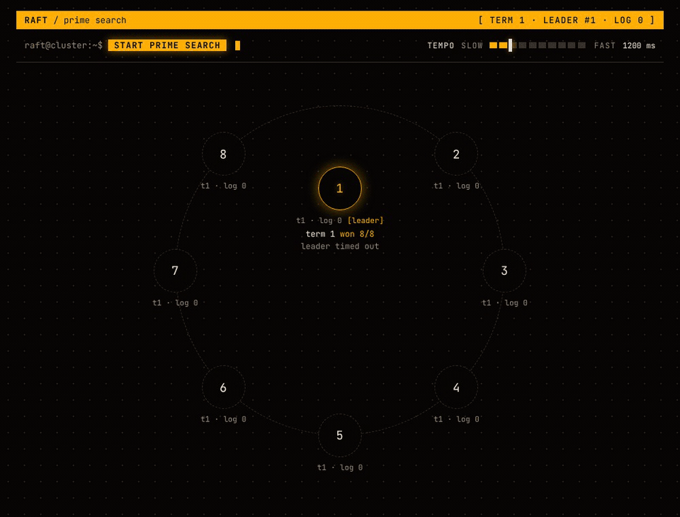

# Raft Consensus Cluster

[](https://github.com/Zambrzyckii/Raft/actions/workflows/ci.yml)
[](https://github.com/Zambrzyckii/Raft/releases/latest)
[](LICENSE)


A Raft consensus cluster written in C# on .NET 10. Eight nodes elect a leader and replicate a log over gRPC. The followers split an open-ended search for prime numbers and propose every prime they find, and the leader commits each one and stores the log in PostgreSQL. The nodes are in-process Kestrel servers, so the whole cluster runs as one process in one container. An Angular dashboard shows it live, with elections, proposals and commits animated as they happen, and a click on a node pauses it so you can watch a failover.



## Run it

You need Docker with Compose.

```bash
git clone https://github.com/Zambrzyckii/Raft.git
cd Raft
cp .env.example .env
docker compose up --build
```

Open http://localhost:5100. The cluster elects a leader and waits, so press `start prime search` in the dashboard (or run `curl -X POST localhost:5100/api/search/start`). The gateway paces the search at 800 ms per checked number and the slider in the header changes it. Click a node to pause or resume it. Found primes are saved to PostgreSQL in batches of 50 (table `primes`, `psql -h localhost -p 5434 -U raft -d raft`, password `raft`).

The tests need the .NET 10 SDK, no database and no Docker. There are 27 of them and they take about 40 seconds.

```bash
dotnet test Raft.sln
```

Every release also publishes the images to GitHub Container Registry as `ghcr.io/zambrzyckii/raft` and `ghcr.io/zambrzyckii/raft-dashboard`. `compose.yaml` itself builds them from source.

## Technologies

* C# and .NET 10 for the nodes (`RaftServer`) and the dashboard gateway (`RaftDashboard`), with `BackgroundService` engines for consensus, the prime search and storage
* The State pattern for the Follower, Candidate and Leader roles, and modulo sharding of the number space over the followers
* gRPC for consensus between nodes (`RaftConsensus.proto`) and for monitoring from the gateway (`RaftMonitoring.proto`)
* SignalR to push the cluster state from the gateway to the browser
* Angular 22 with signals for the dashboard (`dashboard/`)
* PostgreSQL through Npgsql for the registry of found primes
* xUnit for unit tests and in-process failover tests
* Docker Compose for the postgres, cluster and dashboard services, GitHub Actions for CI and for publishing the images

## Known limitations

Some of these are deliberate simplifications of the Raft paper, the others are known gaps.

* No commit index. A follower appends a number as soon as `AppendEntries` delivers it, before the leader has counted the acknowledgements, so a follower can hold an entry that no majority committed. Replication is set based, with no log matching and no backtracking.
* Static work pool. `DynamicWorkDivider` shards numbers by modulo over the full peer list minus the current leader, so numbers that belong to a crashed follower are never recomputed. With three nodes and one of them dead, the surviving follower can be left with a shard of only even numbers, which holds no prime beyond 2.
* Votes carry no term. `AppendResponse` returns the responder's term and a stale leader steps down, but `VoteResponse` has only `voteGranted`, so a candidate learns about newer terms only from incoming RPCs.
* Raft state is not persisted. Term, vote and log live in memory and the search restarts from 1, so a restarted process finds and commits the same numbers again. The PostgreSQL registry absorbs the duplicates with `ON CONFLICT DO NOTHING`.
* Incomplete tail in PostgreSQL. The leader writes only full batches of 50, so the last primes of an unfinished batch are never stored.
* One process. All nodes and the storage service share a single process, so a node failure is simulated by pausing it in the dashboard, and stopping the process stops the whole cluster.
* No catch-up after a pause. A paused node rejects consensus calls and after a resume receives only new commits, because `AppendEntries` carries a single number, so its in-memory log keeps the gap.
* Extra elections. With eight nodes the leader is sometimes replaced without any failure. In one run an idle cluster, waiting for the start signal, changed leader three times in 163 seconds, and it also happened while the search was running. The cause is not known.
